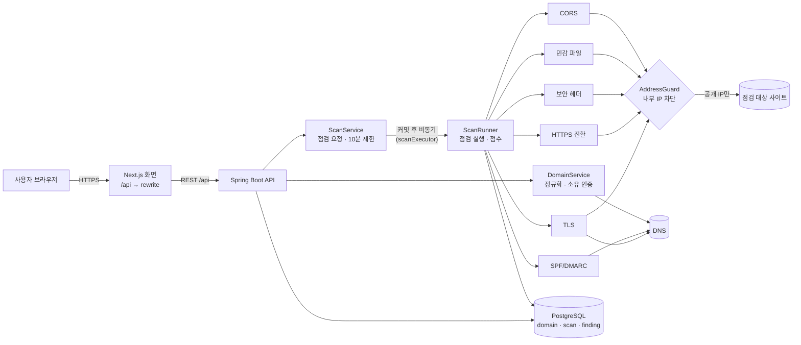

# 문단속 (Mundansok)

> 회사 도메인을 넣으면, 공격자가 밖에서 먼저 보게 될 약점을 찾아 쉬운 말로 알려 주는 **외부 노출 점검 서비스** (개인 프로젝트, 2026.10 ~ 진행 중)

AI 도구로 공격 정찰이 자동화되면서, 노출된 설정 파일 · 만료된 인증서 · 빠진 보안 헤더 · 위조 가능한 메일 도메인이 빠르게 찾아집니다.
문단속은 같은 시선으로, **공격 없이** 내 도메인을 점검하고 무엇부터 고칠지 위험도순으로 알려 줍니다.

| | |
|---|---|
| 서비스 주소 | https://mundansok.vercel.app/ — **평일 11:30 ~ 23:00(KST)** 에만 백엔드를 켭니다. 그 밖의 시간에는 점검이 되지 않습니다 |
| 포트폴리오 상세 | https://ji-geunyeong.kro.kr/projects/mundansok |
| 관련 글 | [점검 서비스가 공격 도구가 되지 않게 만든 세 번의 확인](https://velog.io/@codes-gy/문단속-점검-서비스가-공격-도구가-되지-않게-만든-세-번의-확인) · [상태 코드 대신 본문으로 판정하고, 점검을 늘려도 버티는 구조](https://velog.io/@codes-gy/문단속-상태-코드-대신-본문으로-판정하고-점검을-늘려도-버티는-구조) |
| 기획 산출물 | [docs/planning](docs/planning/README.md) — 헌장, R&R, 요구사항, 유저 스토리, 아키텍처, ERD, API, WBS, 리스크, 협업 규칙 |

## 진행 상황

2026-11-25 기준, GitHub 이슈 · 마일스톤에서 확인한 상태입니다.

| 상태 | 내용 |
|---|---|
| 완료 | **M1 점검 엔진**(이슈 #1~#8 모두 닫힘): 도메인 등록 · DNS TXT 소유 인증, 점검 요청 · 10분 제한 · 비동기 실행, TLS · HTTPS 전환 · 보안 헤더 점검, SSRF 가드, CI |
| 완료 | M2 중 민감 파일 노출(#9) · SPF/DMARC(#10) 점검. 이슈 밖으로 CORS 점검, 운영 지표 · 재시작 정리 · 대기열 포화 처리(PR #27) |
| 코드 있음, 이슈 열림 | 화면(`frontend/`, 도메인 입력 → 소유 인증 → 점검 진행 → 결과 리포트)은 배포 주소에서 열리지만, 이슈 #11(결과 대시보드) · #12(등록 · 인증 화면) · #14(배포 파이프라인 · PostgreSQL 운영 환경)는 아직 열려 있습니다 |
| 계획 | M2 오탐률 측정 — 테스트 도메인 30개(#13) · M3 회원 · 팀 단위 도메인 관리(#15), 점검 이력 · 점수 추이(#16), 정기 점검 · 메일 알림(#17), DNS 리바인딩 대응(#18) · M4 AI 결과 설명(#19), PDF 보고서(#20), 사용성 테스트 · 출시 전 보안 점검(#21) |

## 원칙
- **내 도메인만** — DNS TXT 레코드로 소유를 인증한 도메인만 점검합니다
- **공격하지 않고 확인만** — 일반 GET · TLS 연결 · DNS 조회만 합니다. 로그인 시도 · 대입 공격 · 포트 스캔은 하지 않습니다
- **내부망 차단** — 사설 · 루프백 · 링크 로컬 · CGNAT · IPv6 ULA 주소로 풀리는 호스트는 요청하지 않습니다
- **과한 요청 방지** — 도메인당 10분에 한 번, 요청마다 5초 타임아웃, 응답 본문은 앞 2KB만 읽습니다
- **비밀은 저장하지 않음** — 노출 여부와 근거 요약만 남깁니다

## 점검 항목
| 점검 | 내용 |
|---|---|
| TLS | 인증서 만료 · 호스트 이름 · TLS 버전 · CAA 레코드 |
| HTTPS 전환 | `http://` 접속이 `https://`로 넘어가는지 |
| 보안 헤더 | HSTS(유지 기간 포함) · CSP(인라인 스크립트 허용 포함) · nosniff · 클릭재킹 방지 · Referrer-Policy · 쿠키 Secure · HttpOnly · SameSite · 서버 버전 · X-Powered-By 노출 |
| 민감 파일 | `.git` · `.svn` · `.DS_Store` · `.env` · Actuator env · heapdump(목록만 확인) · server-status · phpinfo · OpenAPI 문서 (본문 서명으로 판정) |
| CORS | 아무 출처나 그대로 허용하는지, 로그인 정보(쿠키)까지 허용하는지 |
| 메일 위조 방지 | SPF · DMARC |

점수는 100점에서 위험도별로 감점합니다(높음 −20, 보통 −10, 낮음 −3, 최저 0 — [`Scores`](src/main/java/dev/codesgy/mundansok/scan/Scores.java)).

## 핵심 문제 해결

### 1. 점검 서비스가 공격 도구가 되지 않게 — 소유 인증, 내부망 차단
- **문제**: 점검 서비스는 그대로 남의 사이트를 정찰하는 도구가 될 수 있고, 점검 요청이 내부망 주소를 향하면 SSRF가 됩니다.
- **해결**: DNS TXT 레코드로 소유를 인증한 도메인만 점검하고([`DomainService`](src/main/java/dev/codesgy/mundansok/domain/DomainService.java)), 등록할 때 내부용 이름을 거절합니다([`DomainNames`](src/main/java/dev/codesgy/mundansok/domain/DomainNames.java)). 요청 직전에는 호스트가 풀리는 모든 IP를 검사해 사설 · 루프백 · 링크 로컬 · CGNAT · IPv6 ULA면 막습니다([`AddressGuard`](src/main/java/dev/codesgy/mundansok/net/AddressGuard.java)). 리다이렉트는 따라가지 않고 본문은 앞 2KB만 읽습니다([`JdkHttpProbe`](src/main/java/dev/codesgy/mundansok/net/JdkHttpProbe.java)).
- **결과**: 인증 전 점검은 `403 DOMAIN_NOT_VERIFIED`, 내부 주소는 등록할 때 이름으로 한 번, 요청 직전에 IP로 한 번 더 막습니다. 인증 뒤 DNS가 내부 IP로 바뀌면 점검 전체를 `FAILED`로 멈춥니다([`ScanRunner`](src/main/java/dev/codesgy/mundansok/scan/ScanRunner.java)). 테스트: [`AddressGuardTest`](src/test/java/dev/codesgy/mundansok/net/AddressGuardTest.java), [`DomainNamesTest`](src/test/java/dev/codesgy/mundansok/domain/DomainNamesTest.java), [`ScanFlowTest`](src/test/java/dev/codesgy/mundansok/api/ScanFlowTest.java)(`인증하지_않은_도메인은_점검하지_않는다`, `내부_주소는_등록할_수_없다`).

### 2. 오탐 줄이기 — 상태 코드가 아니라 본문으로 판정
- **문제**: 모든 주소에 200과 안내 페이지를 주는 SPA에서 `/.env`가 200이라는 이유로 노출로 보면 오탐이 됩니다.
- **해결**: 경로마다 실제 파일 형식(`ref: refs/`, `KEY=값` 줄, `propertySources` 등)이 본문에 있어야 노출로 판정합니다([`ExposedFileCheck`](src/main/java/dev/codesgy/mundansok/check/ExposedFileCheck.java)). DNS 조회가 실패하면 "레코드 없음"이 아니라 "확인 실패"로 따로 알립니다([`EmailAuthCheck`](src/main/java/dev/codesgy/mundansok/check/EmailAuthCheck.java)).
- **결과**: [`ExposedFileCheckTest`](src/test/java/dev/codesgy/mundansok/check/ExposedFileCheckTest.java)의 `모든_주소에_200과_안내_페이지를_주는_사이트는_오탐하지_않는다`, `결과에_비밀_값을_담지_않는다`, [`EmailAuthCheckTest`](src/test/java/dev/codesgy/mundansok/check/EmailAuthCheckTest.java)의 `DNS_조회에_실패하면_없다고_판정하지_않는다`로 확인합니다. 실제 도메인 기준 오탐률 측정(#13)은 아직 하지 않았습니다.

### 3. 점검을 늘려도 흔들리지 않는 구조
- **문제**: 점검 항목은 계속 늘어나는데, 외부 네트워크에 기대는 코드는 테스트가 느리고 불안정합니다.
- **해결**: 점검 하나를 [`Check`](src/main/java/dev/codesgy/mundansok/check/Check.java) 인터페이스 하나로 두고, HTTP · TLS · DNS 접근은 `HttpProbe` · `TlsInspector` · `DnsResolver` 인터페이스 뒤로 숨겨 테스트에서 가짜 구현([`src/test/.../support`](src/test/java/dev/codesgy/mundansok/support))으로 바꿉니다. 점검은 트랜잭션 커밋 뒤 별도 스레드 풀(스레드 4 · 대기열 100, [`AsyncConfig`](src/main/java/dev/codesgy/mundansok/config/AsyncConfig.java))에서 돌려 API 응답과 분리합니다. 점검 하나가 예외로 끝나도 나머지는 계속하고 결과에 "점검을 끝내지 못함"(INFO)으로 남깁니다.
- **결과**: 네트워크 없이 테스트가 돌고, 등록 → 인증 → 점검 → 결과 흐름까지 통합 테스트(`등록_인증_점검_결과까지`)로 확인합니다. CORS 점검은 이 구조에 `Check` 구현 하나로 추가했습니다.

## 구조



점검 상태는 `QUEUED → RUNNING → DONE`이고, 인증 뒤 내부 IP로 바뀌거나 서버 재시작으로 중단되면 `FAILED`입니다. 점검 요청은 바로 202로 응답하고, 화면은 결과가 나올 때까지 2초마다 `GET /api/scans/{id}`를 부릅니다. 시퀀스 · ERD는 [docs/planning/05-architecture.md](docs/planning/05-architecture.md) · [06-erd.md](docs/planning/06-erd.md)에 있습니다.

| 메서드 | 경로 | 설명 |
|---|---|---|
| POST | `/api/domains` | 도메인 등록, 인증용 TXT 레코드 안내 |
| POST | `/api/domains/{id}/verify` | 소유 인증 |
| POST | `/api/domains/{id}/scans` | 점검 요청 (인증된 도메인, 10분에 한 번 — 아니면 `429 SCAN_COOLDOWN`, 풀이 가득 차면 `503 SCAN_QUEUE_FULL`) |
| GET | `/api/scans/{id}` | 점수 · 위험도순 결과 |

자세한 명세: [docs/planning/07-api-spec.md](docs/planning/07-api-spec.md)

## 기술 스택과 설계 결정

| 영역 | 사용 기술 |
|---|---|
| 백엔드 | Java 21 · Spring Boot 4.1 (WebMVC · Data JPA · Validation · Actuator) · Flyway |
| DB | PostgreSQL (로컬 · 테스트는 H2 PostgreSQL 모드) |
| 프론트엔드 | Next.js 16 · React 19 · TypeScript |
| 외부 접근 | JDK HttpClient · SSLSocket · JNDI DNS (추가 의존성 없음) |
| 운영 지표 | Micrometer Prometheus, Prometheus 알림 규칙 |
| 테스트 · CI | JUnit 5 · AssertJ · MockMvc, GitHub Actions |

설계 결정([docs/planning/05-architecture.md](docs/planning/05-architecture.md) ADR 요약):

| 결정 | 이유 |
|---|---|
| 점검 하나 = `Check` 인터페이스 하나 | 점검을 늘려도 실행 · 점수 코드는 그대로 |
| 외부 접근(HTTP · TLS · DNS)은 인터페이스 뒤로 | 테스트를 가짜 구현으로 네트워크 없이 돌림. 실제 구현에서만 SSRF 가드 통과 |
| 점검은 트랜잭션 커밋 후 별도 스레드 풀에서 | API 응답을 점검 시간과 분리. 커밋 전에 실행돼 scan을 못 찾는 문제 방지 |
| 판정은 규칙, AI는 설명만(계획) | 같은 입력에 같은 판정. AI 응답이 달라도 점수가 흔들리지 않음 |
| 상태 코드가 아니라 본문 서명으로 노출 판정 | 모든 주소에 200을 주는 SPA에서 오탐 방지 |
| 노출 파일 내용은 저장하지 않음 | 우리 DB가 비밀 값 저장소가 되는 걸 막음 |
| 화면은 같은 출처 `/api`를 부르고 Next.js rewrites가 백엔드로 넘김 | 백엔드에 CORS 설정이 필요 없음([frontend/README.md](frontend/README.md)) |

## 실행 방법

요구 사항: JDK 21(Gradle toolchain), Node.js

```bash
./gradlew bootRun          # 백엔드 http://localhost:8080, 기본은 메모리 H2(Flyway가 테이블 생성)

cd frontend
npm install
API_BASE_URL=http://localhost:8080 npm run dev   # http://localhost:3000
```

- PostgreSQL을 쓰려면 `DATABASE_URL` · `DATABASE_USERNAME` · `DATABASE_PASSWORD`를 넣고 `./gradlew bootRun`합니다.
- 프론트의 `API_BASE_URL`을 비우면 `http://localhost:8080`을 씁니다.
- 실제 점검은 점검 대상 도메인에 TXT 레코드(`_mundansok-verify.<도메인>`)를 넣을 수 있어야 합니다.

## 테스트

```bash
./gradlew test                                  # 백엔드 (네트워크 · Docker 불필요)
(cd frontend && npm run lint && npm run build)  # 프론트
```

- 테스트 메서드 59개, 매개변수 사례를 펼치면 80개 실행(2026-11-25, `src/test`의 `@Test` · `@ParameterizedTest`와 `@ValueSource` 값으로 셈).
- **점검별 단위 테스트**(`src/test/.../check`): 점검마다 정상 · 문제 · 오탐 사례를 가짜 HTTP · DNS · TLS로 검증합니다.
- **통합 테스트**([`ScanFlowTest`](src/test/java/dev/codesgy/mundansok/api/ScanFlowTest.java)): H2 + Flyway 위에서 MockMvc로 등록 → 인증 → 점검 → 결과를 돌립니다.
- **운영 동작**: 재시작 정리([`ScanRecoveryTest`](src/test/java/dev/codesgy/mundansok/scan/ScanRecoveryTest.java)), 대기열 포화 거절([`ScanRejectionTest`](src/test/java/dev/codesgy/mundansok/scan/ScanRejectionTest.java)), 지표([`ScanMetricsTest`](src/test/java/dev/codesgy/mundansok/scan/ScanMetricsTest.java)).
- **CI**: PR과 `develop` · `main` 푸시마다 [GitHub Actions](.github/workflows/ci.yml)가 `./gradlew test`를 돌립니다. 프론트 lint · build는 CI에 없습니다.
- 알림 규칙은 `promtool check rules monitoring/prometheus-alerts.yml`로 검증합니다.

## 운영 · 관측성
- **지표**: `GET /actuator/prometheus` (actuator는 `health` · `prometheus`만 연다)
  | 지표 | 뜻 |
  |---|---|
  | `mundansok_check_duration_seconds{check, outcome}` | 점검 항목별 실행 시간. `outcome`은 `ok` · `failed`(예외로 끝남 · 내부 주소 차단) |
  | `mundansok_scan_rejected_total` | 점검 풀이 가득 차 거절한 점검 요청 수 |
  | `mundansok_scan_restart_cleaned_total` | 시작 시 재시작 정리로 FAILED 처리한 점검 수 |
  | `executor_active_threads` · `executor_queued_tasks` · `executor_queue_remaining_tasks` `{name="scanExecutor"}` | 점검 풀(스레드 4 · 대기열 100) 상태. Spring Boot가 자동으로 붙인다 |
- **재시작 정리**: 점검은 커밋 뒤 메모리 스레드 풀에서 돌기 때문에, 서버가 재시작되면 돌던 점검이 QUEUED · RUNNING으로 남는다.
  시작할 때(`ApplicationReadyEvent`) `mundansok.scan.stale-after`(기본 15분)보다 오래된 미완료 점검을
  `FAILED`(error: `서버 재시작으로 점검이 중단됨`)로 한 번에 바꾸고 WARN 로그를 남긴다. 기준보다 최근 것은 다른 서버가 돌리고 있을 수 있어 건드리지 않는다.
- **풀 포화**: 스레드와 대기열이 모두 차면 점검 요청은 `503 SCAN_QUEUE_FULL`로 거절하고, 방금 만든 QUEUED 기록은 지운다(쿨다운에 걸리지 않고 바로 다시 요청 가능).
- **알림 규칙**: [monitoring/prometheus-alerts.yml](monitoring/prometheus-alerts.yml) — 점검별 실패율 · 대기열 80% · 거절 발생 · 재시작 정리(정보) · 점검 멈춤.

## 폴더 구조

```
src/main/java/dev/codesgy/mundansok/
  api/       REST 컨트롤러, 오류 응답
  domain/    도메인 등록 · 정규화 · TXT 소유 인증
  scan/      점검 요청 · 실행(ScanRunner) · 점수 · 재시작 정리 · 지표
  check/     점검 6종 (Check 구현)
  net/       외부 접근 인터페이스와 JDK 구현, AddressGuard
  config/    스레드 풀, 설정 값
src/main/resources/db/migration/   Flyway
frontend/    Next.js 화면
monitoring/  Prometheus 알림 규칙
docs/        기획서(PLAN.md), 기획 산출물(planning/)
```

## 한계 · 아직 안 한 것
- **DNS 리바인딩**: 검사 시점과 요청 시점 사이에 IP가 바뀌는 경우를 아직 막지 못합니다. 검증한 IP로 직접 연결하도록 바꿀 계획입니다(#18).
- 서브도메인 탐색(인증서 투명성 로그)은 범위가 커서 MVP에서 뺐습니다.
- TLS 1.0/1.1을 서버가 *지원하는지*는 JDK 클라이언트가 막아 확인할 수 없어, 협상된 버전만 봅니다.
- 점검은 메모리 스레드 풀에서 돌아, 서버가 재시작되면 돌던 점검은 다시 돌리지 않고 `FAILED`로 정리합니다.
- 회원 · 팀, 점검 이력, 정기 점검 · 알림, AI 설명, PDF 보고서는 아직 없습니다(위 [진행 상황](#진행-상황)).

## 기획 산출물
팀 프로젝트 방식(이슈 · PR · 리뷰)으로 진행하기 위해 5인 팀 · 8주 기준으로 작성했습니다. 실제 진행은 개인 프로젝트이며, 팀원은 역할로만 적었습니다 → [docs/planning](docs/planning/README.md)
