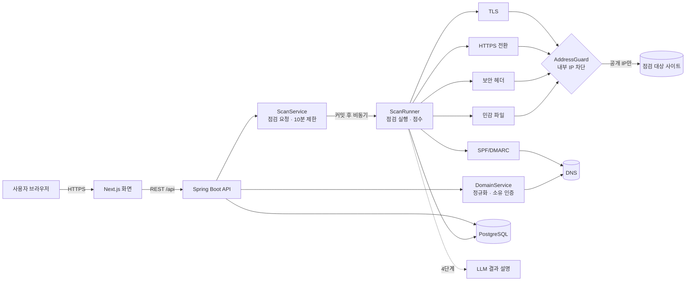
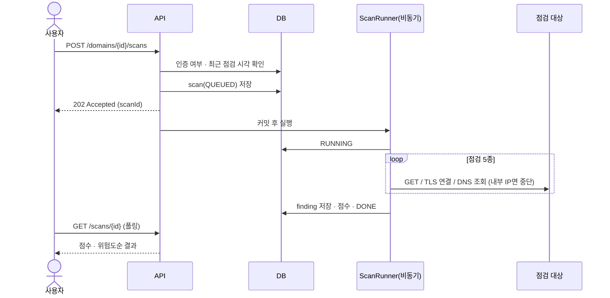

# 05. 시스템 아키텍처

## 구성도

## 점검 흐름

## 설계 결정 (ADR 요약)
| # | 결정 | 이유 |
|---|---|---|
| ADR-1 | 점검 하나 = `Check` 인터페이스 하나 | 점검을 늘려도 실행 · 점수 코드는 그대로. 담당자(BE-1)가 독립적으로 추가 |
| ADR-2 | 외부 접근(HTTP · TLS · DNS)은 인터페이스 뒤로 | 테스트를 가짜 구현으로 네트워크 없이 돌림. 실제 구현에서만 SSRF 가드 통과 |
| ADR-3 | 점검은 트랜잭션 커밋 후 별도 스레드 풀에서 | API 응답을 점검 시간과 분리. 커밋 전에 실행돼 scan을 못 찾는 문제 방지 |
| ADR-4 | 판정은 규칙, AI는 설명만 | 같은 입력에 같은 판정(NFR-05). AI 응답이 달라도 점수가 흔들리지 않음 |
| ADR-5 | 상태 코드가 아니라 본문 서명으로 노출 판정 | 모든 주소에 200을 주는 SPA에서 오탐 방지 |
| ADR-6 | 노출 파일 내용은 저장하지 않음 | 우리 DB가 비밀 값 저장소가 되는 걸 막음(NFR-03) |

## 기술 스택
| 영역 | 선택 |
|---|---|
| 백엔드 | Java 21 · Spring Boot 4.1 (WebMVC · Data JPA · Validation) · Flyway |
| DB | PostgreSQL (로컬 · 테스트는 H2 PostgreSQL 모드) |
| 프론트엔드 | Next.js · TypeScript |
| 외부 접근 | JDK HttpClient · SSLSocket · JNDI DNS (추가 의존성 없음) |
| 테스트 · CI | JUnit 5 · AssertJ · MockMvc, GitHub Actions |
