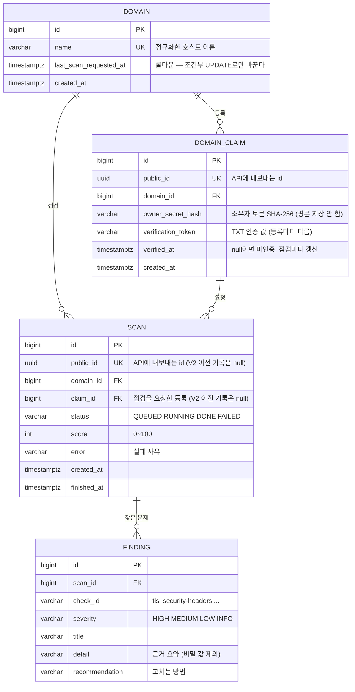

# 06. ERD

## 인덱스
| 인덱스 | 쓰임 |
|---|---|
| `domain(name)` UNIQUE | 도메인 이름당 한 행 (쿨다운 기준) |
| `domain_claim(public_id)` UNIQUE | 등록 조회 |
| `domain_claim(domain_id)` | 도메인별 등록 |
| `scan(public_id)` UNIQUE | 결과 조회 |
| `scan(domain_id, created_at DESC)` | 점검 이력 |
| `finding(scan_id)` | 결과 조회 |

## 3단계 추가 예정
- `member`, `team`, `team_member` — 팀 단위 도메인 관리 (FR-12)
- `domain.team_id` FK, `schedule`(정기 점검 주기 · 다음 실행 시각), `notification`(발송 기록)
