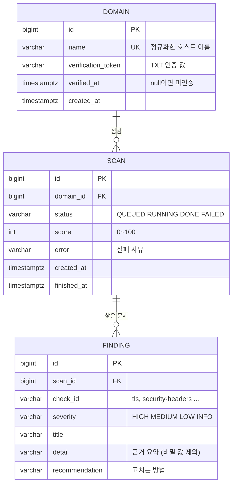

# 06. ERD

## 인덱스
| 인덱스 | 쓰임 |
|---|---|
| `domain(name)` UNIQUE | 같은 도메인 재등록 시 기존 토큰 반환 |
| `scan(domain_id, created_at DESC)` | 10분 제한 확인(도메인별 최근 점검 1건), 점검 이력 |
| `finding(scan_id)` | 결과 조회 |

## 3단계 추가 예정
- `member`, `team`, `team_member` — 팀 단위 도메인 관리 (FR-12)
- `domain.team_id` FK, `schedule`(정기 점검 주기 · 다음 실행 시각), `notification`(발송 기록)
