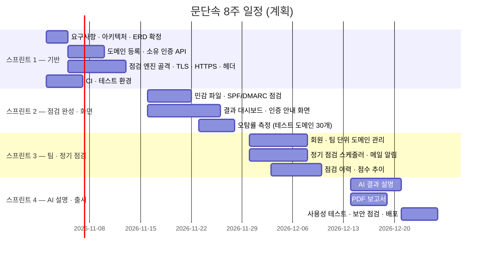

# 08. WBS · 일정

기간: 8주 = 2주 스프린트 × 4 (계획)

## WBS (담당별)
| 스프린트 | PM/BE-L | BE-1 | BE-2 | FE | QA/SEC |
|---|---|---|---|---|---|
| 1 | 요구사항 · ERD, 도메인 인증 API | Check 골격, TLS · HTTPS · 헤더 | 비동기 실행, CI · H2 테스트 환경 | 디자인 시스템, 화면 와이어프레임 | 테스트 전략, SSRF 가드 테스트 |
| 2 | 점검 요청 · 제한, API 문서 | 민감 파일 · SPF/DMARC, 오탐 규칙 | 배포 파이프라인 · 모니터링 | 등록 · 인증 안내 · 결과 대시보드 | 테스트 도메인 30개 구성 · 오탐률 측정 |
| 3 | 회원 · 팀 API | 점검 개선(측정 결과 반영) | 정기 점검 · 메일 알림 | 이력 · 점수 추이, 팀 관리 화면 | 권한 · 오남용 시나리오 테스트 |
| 4 | 출시 범위 관리, 회고 | AI 결과 설명 | 운영 대시보드 · 장애 대응 문서 | PDF 보고서, 접근성 개선 | 사용성 테스트(5명), 출시 전 보안 점검 |

## 마일스톤
| 날짜 | 마일스톤 | 완료 기준 |
|---|---|---|
| 11/13 | M1 점검 엔진 동작 | API로 등록 → 인증 → 점검 → 결과 (현재 저장소: 백엔드 MVP 완료) |
| 11/27 | M2 첫 사용 가능 버전 | 화면에서 전체 흐름, 오탐률 5% 이하 |
| 12/11 | M3 팀 · 정기 점검 | 팀 단위 관리, 매주 자동 점검 · 메일 |
| 12/25 | M4 출시 | AI 설명 · PDF, 사용성 테스트 통과, 배포 |
